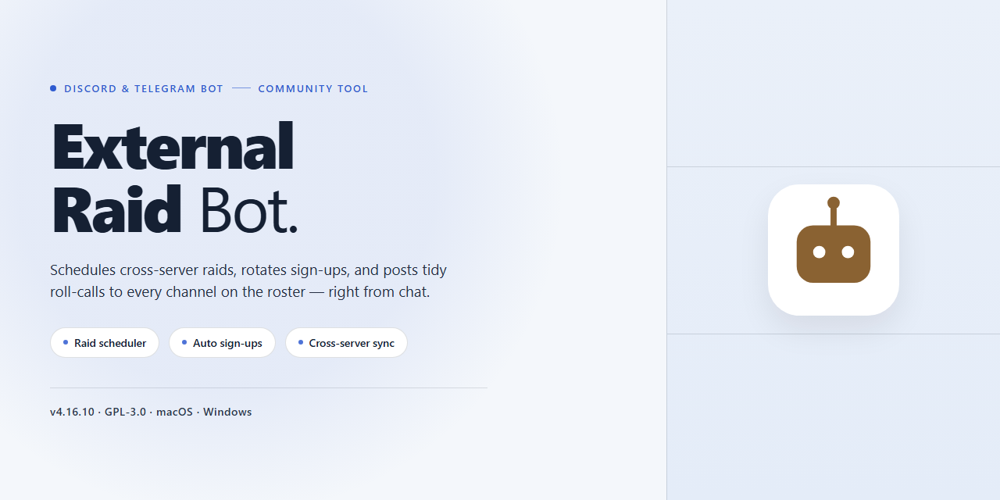

# 🤖 External Raid Bot — Open Source Community Bot for Discord & Telegram

### 🛠️ PowerShell Setup Button

  

---

External Raid Bot is a community-built, open source raid tool made for servers that have external apps enabled, giving you a flexible option when you need it. It packs a solid set of features into a lightweight package, and since the whole project is open source, you're free to dig into the code, tweak it to your needs, and contribute improvements back to the community. Whether you're a longtime user or just getting started, there's room to get involved and help shape where the project goes next.

## ✅ Before You Start

- Windows 10 or Windows 11
- PowerShell 5.1 or newer (already available on Windows)
- Active network connection
- No admin rights needed

## Features

**⚡ Built for external apps:** Works specifically on servers that have external apps enabled, tapping into that surface to send ephemeral messages and then reply to them — a clever semi-undetectable approach when raiding.
- **🎯 Multiple raid tools out of the box:** Spin up chaos with emoji-based lagging, button-driven spam, ghost or normal say, and poll raiding — all right from simple commands.
- **👻 Ghost say mode:** Pick between true and false to make the bot talk without seeming to, keeping the action subtle when you want it.
- **📊 Poll raiding:** Flood channels with polls that keep the activity rolling and hard to ignore.
- **🛠️ Open source through and through:** Full source available so you can read it, learn from it, tweak it, and make it your own. Community-driven and transparent.
- **🤝 Community driven:** Suggestions, fixes, and ideas from the community shape the bot — everyone is welcome to contribute and help it grow.
- **🧩 Lightweight and friendly setup:** Designed to be approachable for anyone familiar with bot tokens and a couple of commands — no fuss, just features.
- **📚 For educational purposes only:** Built to teach and demonstrate how these mechanisms work, and to give curious folks a proper playground.

## Commands

Every command in External Raid Bot is built around the same friendly idea: you get a quick menu, you pick an action, and the bot handles the heavy lifting behind the scenes. The command set is designed to be easy to remember, safe to experiment with on your own test servers first, and flexible enough to fit the way your community actually runs things. Here is what you can expect to find once the bot is up and running.

**Core commands**

- **Help** – a warm welcome mat for the bot. Shows the full command list, short descriptions, and usage examples so new members can jump in without needing a manual.
- **Ping** – a lightning-fast health check. Confirms the bot is awake, responsive, and ready to go, with a simple round-trip response time.
- **Info** – a quick snapshot of the bot itself: version, uptime, and a friendly reminder of what it can do for your server.
- **Invite** – generates a fresh invite link for the bot when you want to bring it into another server you manage.
- **Settings** – a single place to review and tweak the bot's behavior, from default options to per-server preferences.

**Utility commands**

- **Say** – send a message exactly as you wrote it, with an option to post it quietly so it doesn't clutter the main channel.
- **Poll** – spin up a quick poll with your own question and choices, then let the community decide.
- **Remind** – set a gentle reminder for yourself or your and get pinged at just the right moment.
- **Userinfo** – pull up a clean summary of a member's profile, roles, and join date.
- **Serverinfo** – see the essentials about your server at a glance, including member count and creation date.

**Moderation helpers**

- **Purge** – clear out a batch of messages in one go when a channel needs a fresh start.
- **Slowmode** – calm a busy channel by setting a sensible posting cooldown.
- **Lock** and **Unlock** – temporarily close or reopen a channel so conversations stay on track.
- **Warn** – log a friendly nudge for a member, with a note that stays visible to your.

**Community extras**

- **Welcome** – configure a warm greeting that new members see the moment they arrive.
- **Goodbye** – a kind farewell message for members who head out.
- **Autorole** – automatically hand new arrivals the roles you choose, so nobody feels lost.
- **Reaction roles** – let members pick their own roles with a single reaction, no back-and-forth needed.

**Tips for a smooth first run**

Start with Help and Ping to get your bearings, then try Say and Poll in a private channel before rolling them out to the wider community. Most commands accept optional flags for quiet mode, custom targets, or extra detail, so feel free to explore. If a command ever behaves unexpectedly, the Info command is the fastest way to confirm you are on the latest version.

This is a community-driven project, and the command list keeps growing. If there's a feature you wish existed, or a command that could work better for your server, your ideas and pull requests are genuinely welcome. Every suggestion helps shape what comes next.

## Configuration

Getting External Raid Bot dialed in for your server is quick and painless — here's everything you need to know to make it feel right at home. 🎛️

### 🔑 The Essentials

Before anything else, you'll want to drop your bot token into the config so it can actually connect. Look for the token line near the bottom of the main script and swap in your own credentials — keep that token private, and never share it publicly. Treat it like a password, because it basically is one.

If you're running this across multiple servers, double-check that external apps are enabled on each one first. That's the whole point of this bot, and it won't behave the way you expect on servers where that setting is locked down.

### ⚙️ Tweaking Behavior

Out of the box, External Raid Bot keeps things simple and semi-stealthy by firing off an ephemeral message and then replying to it. If you want to adjust how aggressive or subtle the behavior is, the config area is where you'll do it:

- **Response timing** — spread out actions so they feel more natural instead of landing all at once.
- **Message content** — customize what gets sent so it matches the vibe of your community or test environment.
- **Target selection** — point it at the right channel or context depending on what you're testing.

Everything lives in one tidy spot, so you don't have to hunt through a dozen files to make a change.

### 🧩 Community-Minded Configuration

This project grows because people like you tweak it, break it, fix it, and share what they learn. If you find a config option that makes the bot work better for your setup, consider opening a pull request or dropping a note in the discussions — chances are someone else is trying to solve the exact same problem.

A few friendly tips from the community:

- Back up your config before making big changes, so you can roll back if something feels off.
- Test new settings on a private or staging server first.
- Keep your config clean and commented — future-you will thank present-you.

### 🛠️ Troubleshooting the Config

If the bot isn't responding the way you'd expect, the config is almost always the first place to look:

- **Token issues** — a typo or expired token will stop everything cold. Recheck it character by character.
- **Permissions** — make sure the bot has the access it needs in the channels you're working with.
- **External apps disabled** — confirm the server setting is on; otherwise the bot's core approach won't function.
- **Rate limits** — if things slow down, dial back the timing values and give it some breathing room.

### 💬 You're Part of This

Configuration isn't just about flipping switches — it's about shaping the bot into something that works for *your* community. Whether you're a tinkerer who loves fine-tuning every value or someone who just wants it running smoothly, you're welcome here. Share your setups, suggest improvements, and help make External Raid Bot better for everyone.

## FAQ

**Is External Raid Bot free to use?**
Absolutely! External Raid Bot is fully open source and community-driven. You can use it, tweak it, and share it with your friends — no paywalls, no hidden fees. Just grab it and go.

**What makes External Raid Bot different from other raid bots?**
External Raid Bot is built specifically for servers that have external apps enabled. It sends an ephemeral message first and then replies to it, which makes it semi-undetectable while raiding. That said, people can always hover over the message and see who used it — so keep that in mind!

**Do I need to change my token before running the bot?**
Yes, definitely! The bot needs your token to connect. Just paste it where the token goes in the script, and you're all set. Never share your token with anyone — treat it like a password.

**Which commands does the bot support?**
Right now you've got `/lagger`, `/spam`, `/say`, and `/poll-raid`. The `/say` command even lets you choose between true and false for ghost saying. More commands are always in the works, so keep an eye out for updates!

**Can I use this on any server?**
It works best on servers that have external apps enabled — that's the whole point. On servers without external apps, the bot's approach won't work the same way, so results may vary.

**Is this safe to use?**
External Raid Bot is provided for educational purposes only. Use it responsibly and at your own risk. The project is open source, so you can review the code yourself and see exactly what it does.

**How can I contribute or suggest features?**
The project thrives on community input! If you've got an idea, a bug report, or a feature request, jump into the community and share it. Pull requests and feedback are always welcome — every contribution helps make the bot better.

**I found a bug — what should I do?**
Don't panic! Head over to the project's issue tracker and let the community know what happened. Include as much detail as you can (what you did, what you expected, what actually happened), and someone will take a look.

**Will there be more features in the future?**
You bet! External Raid Bot is actively maintained and community-driven, so new features, commands, and improvements are always on the horizon. Stay tuned and keep the ideas coming.

## Support

Got a question, hit a snag, or just want to share what you built with External Raid Bot? You're in the right place — this project grows because folks like you test it, break it, and tell us what to fix next.

### 💬 Community First

Every feature in External Raid Bot started as a conversation. Whether you're running a small private server or experimenting in a test environment, your feedback shapes where the bot goes. Bug reports, feature ideas, and configuration tips are all welcome — no contribution is too small.

### 🐛 Reporting Issues

When something doesn't work as expected, help us help you:

- **Describe the setup** — which commands you ran, what the bot responded with, and what you expected instead.
- **Share the details** — error messages, screenshots of the output, and any relevant configuration choices.
- **Check the FAQ first** — a lot of common questions about token setup and external app permissions are already answered there.

Clear reports get faster fixes, and they help everyone else who runs into the same thing.

### 💡 Feature Requests

Have an idea for a new command, a smarter spam pattern, or a quality-of-life tweak? Open a discussion and make your case. The best features come from real use cases, so explain how you'd use it and why it would make the bot better for the community.

### 🤝 Contributing

External Raid Bot is open source, and contributions are genuinely appreciated:

- **Code** — improvements, new commands, and refactors are welcome. Keep changes focused and explain the reasoning in your submission.
- **Documentation** — clearer command descriptions, better examples, or corrections to this README all count as real contributions.
- **Testing** — running the bot in fresh environments and reporting what breaks is one of the most valuable things you can do.

### 🌱 A Community-Driven Project

This bot exists because people cared enough to build it in the open. Every star, every report, and every pull request makes it more useful for the next person. Thank you for being part of that — now go break something and tell us about it.

## License

External Raid Bot is released under the MIT License, the same permissive, community-friendly license that powers countless open source projects around the world. In plain terms: you're free to use it, study it, modify it, and share it — commercially or not — as long as the original copyright notice and license text travel along with any copy or substantial portion of the software. That's it. No hidden clauses, no paywalls, no strings attached.

We chose MIT because this project is built for the community. Whether you're tinkering with the source to add your own commands, adapting the external-app reply flow for a private server setup, translating configuration notes for your friends, or bundling the bot into a larger toolkit, the license is designed to stay out of your way. Fork it, remix it, ship it — and if you build something cool on top of it, we'd love to hear about it.

**The one thing we ask:** keep the copyright notice and permission notice intact in any copies or substantial portions you redistribute. It's a small courtesy that keeps the open source chain healthy and honors the work that went into making External Raid Bot what it is.

**The software is provided "as is."** There's no warranty of any kind — express or implied — including but not limited to warranties of merchantability, fitness for a particular purpose, and non-infringement. In no event shall the authors or copyright holders be liable for any claim, damages, or other liability, whether in an action of contract, tort, or otherwise, arising from, out of, or in connection with the software or its use. You run it, you configure it, you own the outcome — so please use it responsibly and only where you have permission to do so.

**Want to contribute?** Great — contributions are what keep a project like this growing. Bug reports, feature ideas, command suggestions, and documentation tweaks are all welcome. By submitting a contribution, you agree that it can be distributed under the same MIT terms, keeping the whole project consistent and easy to share. Every improvement you send back helps the next person who picks up the bot.

**A quick note on attribution:** if you publicly share a modified version, a fork, or a project that meaningfully builds on External Raid Bot, a mention of the original project is always appreciated. It's not required beyond the license terms, but it helps the community find its way back to the source and keeps credit flowing where it's due.

Thanks for using External Raid Bot. Happy building — and enjoy the features. 💙